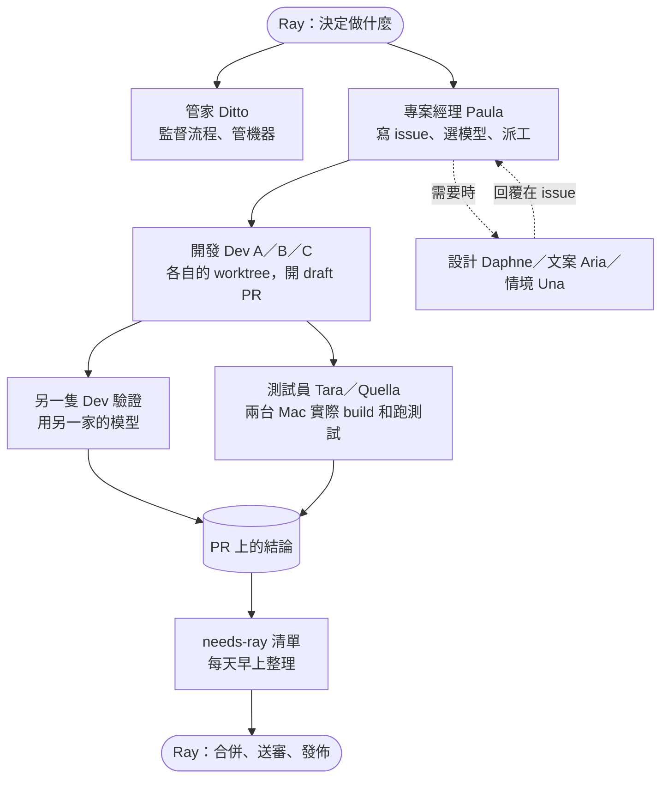

# 一個人的軟體公司

我和 13 隻 AI bot，把一個 App 做上 App Store。

這個 repo 放的不是 App 的程式碼，是「這組 bot 怎麼一起工作」的規則原文：每隻 bot 的說明、共用的工作流程（skill）、真實的派工訊息和測試報告。

- 產品：[MarsDawn](https://marsdawn.southern-light.dev)，Mac 上的 Markdown 編輯器
- App Store：<https://apps.apple.com/app/id6812925073>
- 作者：Ray（唯一的人）

## 數字

| 項目 | 數字 |
|---|---|
| 人 | 1 |
| AI bot | 13 |
| Mac App Store 已上架版本 | 6 個，目前 1.2.1 |
| 2026-10-20 到 11-12 合併的 PR | 174 張（App 77、官網 46、共用套件 51） |
| 合併、送審、發佈由誰做 | 只有人 |

## 流程

1. Ray 用手機或電腦跟 bot 說要做什麼。
2. 專案經理把需求寫成 GitHub issue，選好模型，派給一隻開發 bot。
3. 開發 bot 在自己的 git worktree 寫 code，開 draft PR。
4. 另一隻 bot 用另一家的模型驗證。Claude 寫的給 Codex 驗，反過來也一樣。
5. 測試 bot 在 Mac 上實際 build、跑測試、看實機，結果貼回 PR。
6. 要 Ray 決定的事貼上 `needs-ray` 標籤，每天早上整理成一張清單。
7. 合併、送審、對外發文只有 Ray 能做。

## 13 隻 bot

| bot | 做什麼 |
|---|---|
| 管家 Ditto | 監督流程順不順、建立和調整 bot、管機器和磁碟 |
| 專案經理 Paula | 管 milestone 和 issue、選模型、派工、追到 PR 驗證完 |
| 開發 Dev A／B／C | 寫 code、開 PR、互相驗證 |
| 測試員 Tara | 在 Mac mini 跑不佔螢幕的測試和反向檢查 |
| 測試員 Quella | 在 MacBook Air 跑模擬器、實機、截圖、archive |
| 設計審閱 Daphne | 審 UI，回覆設計規格 |
| 文案語系 Aria | 寫文案，處理多語 |
| 情境驗證 Una | 從使用者情境找問題，提 idea |
| 部落格 Wendy | 寫產品部落格 |
| 影片製作 Vera | 做產品介紹影片 |
| 知識庫 Olive | 整理筆記庫，每週回顧 |

bot 跑在 Codync 上，引擎是 Claude Code。開發 bot 也會呼叫 Codex（GPT）和 Antigravity（Gemini）。

## 這個 repo 裡有什麼

| 路徑 | 內容 |
|---|---|
| [`bots/`](bots/) | 3 隻 bot 的常駐說明原文：專案經理、開發、測試員 |
| [`skills/dev-ticket/`](skills/dev-ticket/SKILL.md) | 開發 bot 做一張票的完整流程 |
| [`skills/pr-verify/`](skills/pr-verify/SKILL.md) | 驗證別人的 PR：實際跑、反向檢查、結論怎麼寫 |
| [`skills/mba-test-request/`](skills/mba-test-request/SKILL.md) | 請測試 bot 跑測試的固定格式，還有搶同一台 Mac 時的鎖 |
| [`skills/gh-handoff/`](skills/gh-handoff/SKILL.md) | bot 之間在 GitHub 上交接的規則 |
| [`skills/pm-brief/`](skills/pm-brief/SKILL.md) | bot 跟人回報的固定寫法 |
| [`scripts/pr-status`](scripts/pr-status) | 十幾行印完一張 PR 的狀態，省 token 用 |
| [`examples/dispatch-and-report.md`](examples/dispatch-and-report.md) | 一則真實的派工訊息和回報 |
| [`examples/test-report.md`](examples/test-report.md) | 一份真實的測試報告，反向檢查抓到 2 個沒測到東西的測試 |

檔案是從實際在用的版本複製出來的。本機路徑、bot id、機器名稱、信箱換成了 `<vault>`、`<bot-id>`、`<mba>`、`<bot-email>` 這類佔位符，其他沒有改。規則裡的日期和「Ray 11-09」這類標記，是那條規則定下來的時間。

## 學到的事

這些規則大部分是出過事才加的。

- **只審 code 不夠。** 有 3 張 PR 是審查通過、實際跑才發現失敗。所以 Swift 的 PR 一定要在實機跑過才算通過。見 `skills/pr-verify`。
- **測試要做反向檢查。** 把修正拿掉再跑一次，測試沒變紅就代表它沒測到東西。見 `examples/test-report.md`。
- **對話越長越貴。** 11 月上旬，3 隻開發 bot 佔了七成用量，因為每一步都要重讀幾十萬 token 的對話。改成一張票開一個 subagent、提早壓縮對話之後，第一天量到開發 bot 主對話每張 PR 的呼叫次數少了約 80%。見 `skills/dev-ticket` 第 0 節。
- **不要讓 bot 等。** 用迴圈反覆查狀態很花錢。現在的規則是回報「等待中」就結束這一輪，條件到了再叫它。
- **模型要分級。** 查找用小模型，機械式工作和一般實作用中模型，驗證才用大模型。全部用最大的模型，省下來的又會被吃掉。
- **bot 會撞票，也會搶螢幕。** 所以有排隊、有鎖，開工前要先查有沒有人在做同一張票。
- **要人決定的事要有固定的地方。** 寫在聊天裡會被洗掉。現在一律寫在 issue 上並貼標籤，每天早上整理一次。

## 限制

- 合併、送審、發佈都要人來做。這是刻意的。
- 這套做法只在作者自己的專案用過，沒有給別人用過。
- 檔案是某一天的快照，實際在用的版本每週都在改。
- App 的原始碼是私人的，不在這裡。範例裡的 PR 連結外人打不開。
